<a href="https://meu-portfolio-robsonrodrigues.vercel.app/">
  
</a>

  &nbsp;
  


🇧🇷 <b>Em português</b>

 

Sou **Robson Rodrigues**, desenvolvedor front-end em **Brasília**. Faço sites e produtos web rápidos, acessíveis e bonitos com React e Next.js, para clientes no Brasil e no exterior. Também sou cofundador da **[RDL Development](https://rdldevelopment.dev)**, com Daniel Maciel e Luiz Henrique.

- 🎓 Formado em Análise e Desenvolvimento de Sistemas no **IFG** (2026)
- 🚀 Construindo agora: **Candidarte**, um painel de candidaturas de emprego com IA
- 💬 Atendo em português e inglês e respondo em até 24 horas

👉 [Ver o portfólio em português](https://meu-portfolio-robsonrodrigues.vercel.app/pt)

 

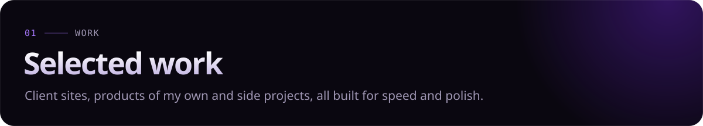

  <a href="https://simula-sisu.vercel.app">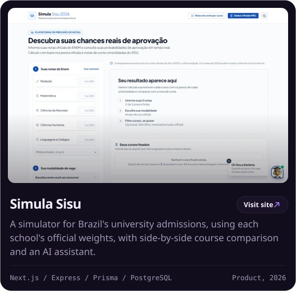</a>
  <a href="https://www.gabrieladecoracoes.com.br/">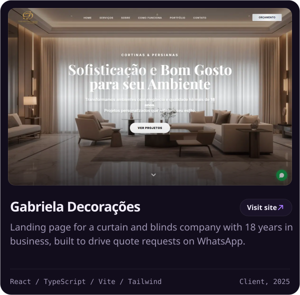</a>
  <a href="https://shineditor.vercel.app">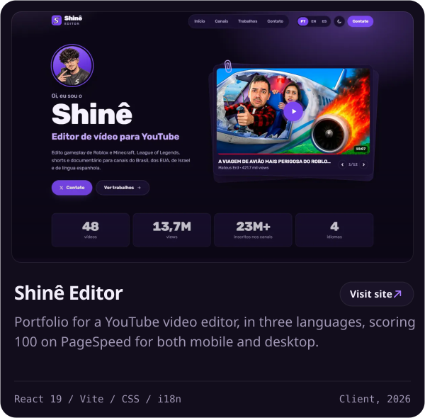</a>
  <a href="https://meu-portfolio-robsonrodrigues.vercel.app/#projetos">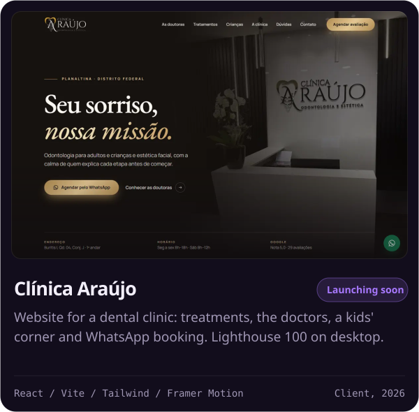</a>
  <a href="https://rdldevelopment.dev">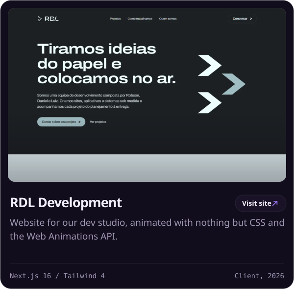</a>
  <a href="https://candangos-shop.vercel.app/">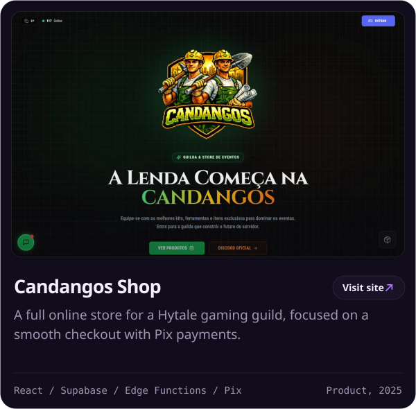</a>
  <a href="https://github.com/RobsonRodriguess/Mind-Health">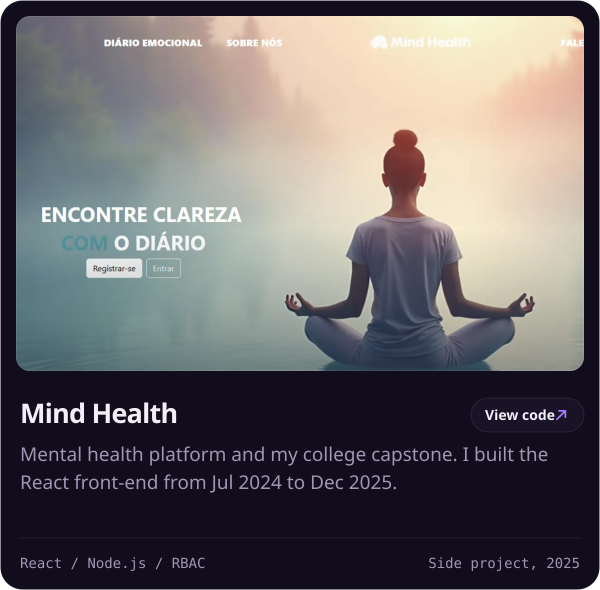</a>
  <a href="https://github.com/RobsonRodriguess/aviator-clone-pro">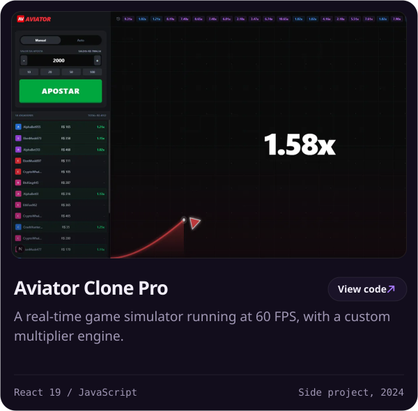</a>

 

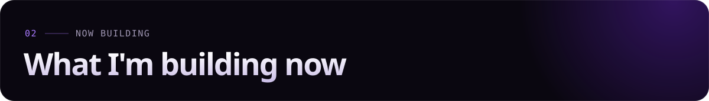

<a href="https://meu-portfolio-robsonrodrigues.vercel.app/#candidarte">
  
</a>

  

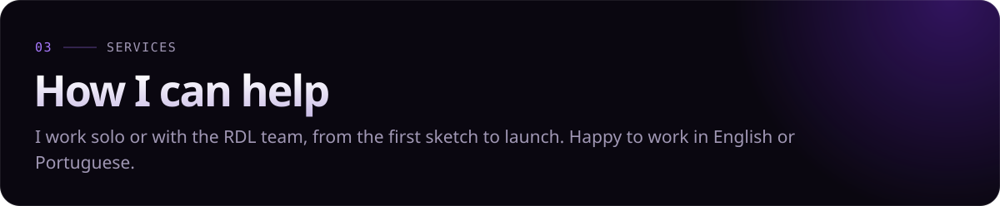

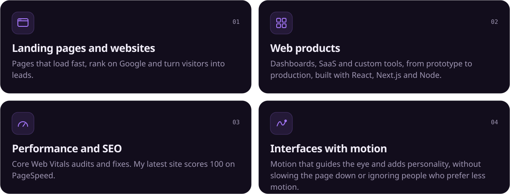

  

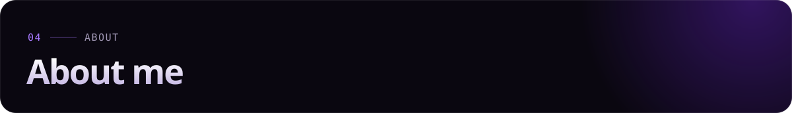

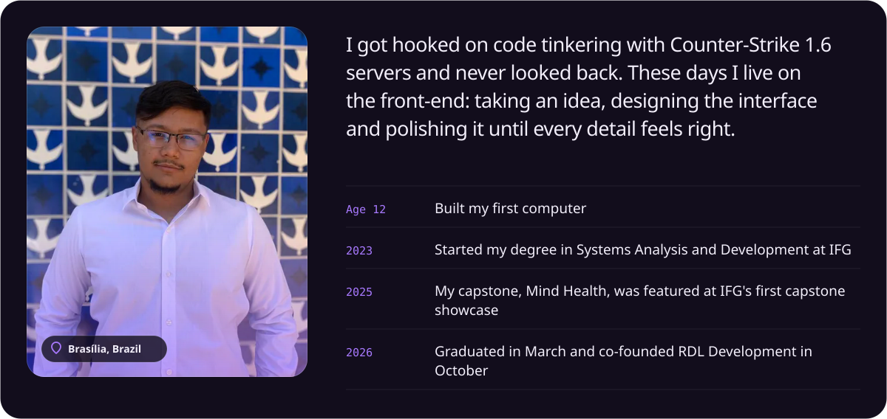

  

<a href="https://rdldevelopment.dev">
  
</a>

  

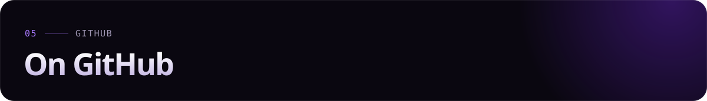

  
  

  

<picture>
  <source media="(prefers-color-scheme: dark)" srcset="https://raw.githubusercontent.com/RobsonRodriguess/RobsonRodriguess/output/github-contribution-grid-snake-dark.svg">
  <source media="(prefers-color-scheme: light)" srcset="https://raw.githubusercontent.com/RobsonRodriguess/RobsonRodriguess/output/github-contribution-grid-snake.svg">
  
</picture>

  

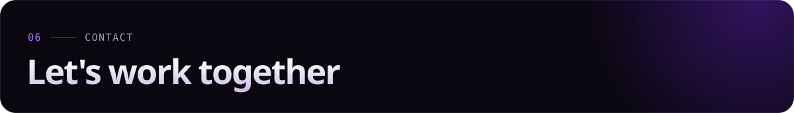

<a href="https://meu-portfolio-robsonrodrigues.vercel.app/#contato">
  
</a>

  &nbsp;
  &nbsp;
  

